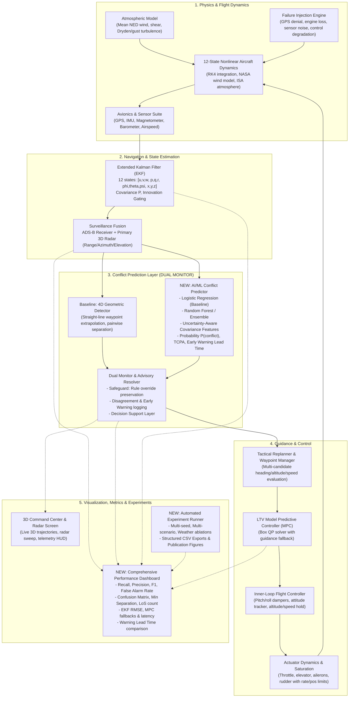

# Architectural Map & Implementation Plan: AI-Assisted Air Traffic Conflict Prediction & Resolution

**Project Name:** 3D Aircraft Radar Command Center & Autonomous ATC System  
**Environment:** MATLAB R2025b Update 7 (64-bit Windows)  
**Toolboxes Available:** Aerospace Toolbox, Aerospace Blockset, Control System, Optimization, Statistics and Machine Learning, Deep Learning, Signal Processing, Robotics System, Navigation.

---

## 1. System Architecture Map (Phase 1)

---

## 2. Identified Gaps & Integration Strategy (Phase 2)

| Component | Existing Baseline | Target Enhancement | Integration Strategy |
| :--- | :--- | :--- | :--- |
| **Conflict Prediction** | 4D geometric trajectory extrapolation (`conflict_detector_4d`) | Machine Learning Predictor (Logistic Regression + Random Forest) | Add causal feature extractor; train models on simulated encounters; run concurrently in `atc_cycle`. |
| **Safety Architecture** | Hardcoded geometric thresholding | Dual-monitoring: ML advisory + rule-based safety backstop | ML never overrides safe ATC rule; flags early warning; reports agreement/disagreement. |
| **Uncertainty Awareness** | EKF covariance is logged but not utilized in conflict probability | Propagate EKF position covariance $\mathbf{P}$ to CPA to derive probabilistic conflict metrics and confidence ellipses | Compute trace of joint covariance; evaluate Mahalanobis distance to separation boundary. |
| **Metrics & Validation** | Basic detection counts and min separation | Full classification metrics: Recall, Precision, F1, FPR, Confusion Matrix, Lead Time, EKF RMSE, MPC Latency | Create unified metrics evaluation pipeline; export structured CSVs for all trials. |
| **Dashboard & UI** | 3D figure HUD + text summary | Comprehensive interactive evaluation dashboard + publication plots | Add dedicated dashboard module with interactive scenario controls, ROC curves, and confusion matrix. |
| **Experimentation** | Single script Monte Carlo | Modular automated experiment runner supporting parameter sweeps, weather severity, and CSV export | Build `experiment_runner.m` with batch execution, reproducibility seeding, and summary tables. |

---

## 3. Implementation Workflow Stages

- **Stage 1 (Phases 1-3):** Architectural verification, baseline regression test suite, and clean interfaces.
- **Stage 2 (Phase 4):** Reliable logging, event recorder, and structured CSV exporter.
- **Stage 3 (Phase 5):** AI/ML Feature Extractor, Dataset Generator, Model Training (Logistic Regression & Random Forest), Evaluation & Calibration.
- **Stage 4 (Phase 6):** Integration into `atc_cycle` and GUI / Radar visualization as a dual-monitor advisory layer.
- **Stage 5 (Phase 7):** Environmental uncertainty (Calm, Moderate, Severe), sensor drop/noise stress testing, and covariance propagation.
- **Stage 6 (Phase 8):** Comprehensive performance dashboard, comparison figures, documentation, and research report.
