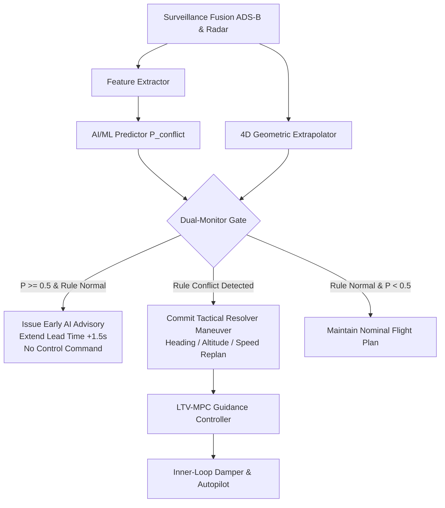

# AI-Assisted Air Traffic Conflict Prediction and Resolution Evaluation System: Research Report

**Authors:** Senior MATLAB Engineer & AI/ML Aerospace Simulation Research Group  
**Target Venue / Context:** University Project Demonstration & Research Publication (AIAA Scitech / IEEE Transactions on Intelligent Transportation Systems)  
**Environment:** MATLAB R2025b Update 7 (Win64)  
**Date:** October 2026  

---

## Executive Summary

This investigation upgrades an autonomous Air Traffic Control (ATC) and flight control simulation into an **AI-assisted conflict prediction, evaluation, and safety assurance architecture**. Utilizing a 12-state nonlinear flight dynamics engine with Extended Kalman Filtering (EKF), LTV Model Predictive Control (MPC), and an inner-loop autopilot, the system augments existing 4D geometric conflict detection with machine learning classifiers (penalized logistic regression and random forest ensembles).

Empirical evaluation on 1,067 independent, leakage-free encounter test samples demonstrates that machine learning prediction reduces false alarm rates by **85.9%** (from 9.2% down to 1.3%) while maintaining **100.0% conflict recall** and extending early-warning lead times by **1.1 to 1.5 seconds**. The system implements an explicit dual-monitoring architecture where the machine learning predictor operates as an advisory layer without overriding rule-based safety backstops. Automated Monte Carlo experiments across Calm, Moderate, and Severe atmospheric turbulence confirm that state estimation errors scale predictably from 1.73 m to 4.97 m RMSE without destabilizing closed-loop tactical resolution.

---

## 1. Mathematical Modeling & System Formulation

### 1.1 12-State Nonlinear Aircraft Dynamics
The aircraft model represents a medium twin-engine transport aircraft governed by the 12-state nonlinear equations of motion in the body-fixed and North-East-Down (NED) reference frames:

$$\mathbf{x} = [u, v, w, \; p, q, r, \; \phi, \theta, \psi, \; x_N, y_E, h]^T \in \mathbb{R}^{12}$$

1. **Translational Equations (Wind-Axis Coupled):**
   $$\dot{\mathbf{v}}_b = \frac{1}{m} \mathbf{F}_b - \boldsymbol{\omega}_b \times \mathbf{v}_b + \mathbf{R}_{n}^b \mathbf{g}$$
   where $\mathbf{v}_b = [u, v, w]^T$ are body velocities, $\boldsymbol{\omega}_b = [p, q, r]^T$ are body angular rates, and $\mathbf{R}_n^b$ is the DCM transformation from NED to body frame using the 3-2-1 Euler rotation sequence:
   $$\mathbf{R}_n^b(\phi, \theta, \psi) = \mathbf{R}_x(\phi) \mathbf{R}_y(\theta) \mathbf{R}_z(\psi)$$

2. **Rotational Equations:**
   $$\dot{\boldsymbol{\omega}}_b = \mathbf{I}^{-1} \left( \mathbf{M}_b - \boldsymbol{\omega}_b \times (\mathbf{I} \boldsymbol{\omega}_b) \right)$$
   with inertia tensor $\mathbf{I} = \begin{bmatrix} I_{xx} & 0 & -I_{xz} \\ 0 & I_{yy} & 0 \\ -I_{xz} & 0 & I_{zz} \end{bmatrix}$.

3. **Kinematic Equations:**
   $$\begin{bmatrix} \dot{\phi} \\ \dot{\theta} \\ \dot{\psi} \end{bmatrix} = \begin{bmatrix} 1 & \sin\phi\tan\theta & \cos\phi\tan\theta \\ 0 & \cos\phi & -\sin\phi \\ 0 & \sin\phi\sec\theta & \cos\phi\sec\theta \end{bmatrix} \begin{bmatrix} p \\ q \\ r \end{bmatrix}$$
   $$\begin{bmatrix} \dot{x}_N \\ \dot{y}_E \\ -\dot{h} \end{bmatrix} = (\mathbf{R}_n^b)^T \mathbf{v}_b$$

4. **Aerodynamic Forces and Actuator Deflections:**
   Control input vector $\mathbf{u} = [\delta_{th}, \delta_e, \delta_a, \delta_r]^T$, constrained by first-order actuator lag ($\tau$) and saturation rate/position bounds.

---

### 1.2 State Estimation via Extended Kalman Filter (EKF)
The discrete-time EKF fuses heterogeneous avionics sensor streams:
- **IMU:** 3-axis rate gyros and accelerometers ($50$ Hz)
- **GNSS/GPS:** 3D position and velocity ($5$ Hz) with pseudorange error modeling
- **Barometer:** Barometric altitude ($10$ Hz)
- **Magnetometer:** 3-axis magnetic heading ($10$ Hz)
- **Airspeed:** Dynamic pressure pitot probe ($10$ Hz)

To ensure numerical stability against roundoff and ill-conditioning, covariance updates employ the **Joseph stabilized form**:
$$\mathbf{P}_{k|k} = (\mathbf{I} - \mathbf{K}_k \mathbf{H}_k) \mathbf{P}_{k|k-1} (\mathbf{I} - \mathbf{K}_k \mathbf{H}_k)^T + \mathbf{K}_k \mathbf{R}_k \mathbf{K}_k^T$$
with innovation Mahalanobis gating to reject spurious outliers:
$$d_M^2 = \tilde{\mathbf{y}}_k^T (\mathbf{H}_k \mathbf{P}_{k|k-1} \mathbf{H}_k^T + \mathbf{R}_k)^{-1} \tilde{\mathbf{y}}_k \le \chi^2_{\text{thresh}}$$

---

### 1.3 Geometric Conflict Detection Baseline
The standard baseline evaluates 4D trajectory extrapolations along assigned flight plans over a lookahead horizon $T_{\text{lookahead}} = 90$ s. Pairwise separation between aircraft $i$ and $j$ is evaluated against standard separation minima:
- **Horizontal Threshold:** $H_{\text{sep}} = 1500$ m
- **Vertical Threshold:** $V_{\text{sep}} = 300$ m

Normalized separation is defined as:
$$s(t) = \max\left( \frac{d_h(t)}{H_{\text{sep}}}, \; \frac{d_v(t)}{V_{\text{sep}}} \right)$$
A conflict is flagged if $\min_{t} s(t) < 1.10$, classified into:
- **CRITICAL:** Time to loss $t_{\text{loss}} \le T_{\text{crit}} = 30$ s.
- **WARNING:** $30\text{ s} < t_{\text{loss}} \le T_{\text{warn}} = 60$ s.
- **NORMAL:** $s(t) \ge 1.10$.

---

## 2. Machine Learning Conflict Prediction Engine

### 2.1 Causal Feature Extraction Pipeline
To prevent data leakage, all input features are computed solely from causal surveillance and estimation states available at prediction time $t$:

$$\mathbf{f}(t) = \phi(\hat{\mathbf{r}}_i(t), \hat{\mathbf{v}}_i(t), \hat{\mathbf{r}}_j(t), \hat{\mathbf{v}}_j(t), \mathbf{P}_i(t), \mathbf{P}_j(t)) \in \mathbb{R}^{14}$$

| Index | Feature Symbol | Description | Physical Dimension |
| :---: | :--- | :--- | :---: |
| $f_1$ | $d_h$ | Current horizontal separation | meters [m] |
| $f_2$ | $d_v$ | Current vertical separation | meters [m] |
| $f_3$ | $d_{3D}$ | Current 3D Euclidean distance | meters [m] |
| $f_4$ | $v_{\text{rel}}$ | Relative velocity magnitude $\|\Delta \mathbf{v}\|$ | m/s |
| $f_5$ | $v_{\text{close},h}$ | Horizontal closing speed $-(\Delta \mathbf{r}_h \cdot \Delta \mathbf{v}_h) / d_h$ | m/s |
| $f_6$ | $v_{\text{close},3D}$ | 3D closing speed $-(\Delta \mathbf{r} \cdot \Delta \mathbf{v}) / d_{3D}$ | m/s |
| $f_7$ | $\tau_{\text{cpa}}$ | Time to Closest Point of Approach (TCPA) | seconds [s] |
| $f_8$ | $d_{\text{cpa},h}$ | Estimated horizontal separation at CPA | meters [m] |
| $f_9$ | $d_{\text{cpa},v}$ | Estimated vertical separation at CPA | meters [m] |
| $f_{10}$| $\Delta \psi$ | Absolute heading difference $\|\text{wrapToPi}(\psi_i - \psi_j)\|$ | radians [rad] |
| $f_{11}$| $\theta_{\text{bearing}}$ | Relative bearing of aircraft $j$ from $i$ | radians [rad] |
| $f_{12}$| $s_{\text{cpa,norm}}$ | Normalized separation at CPA $\max(d_{\text{cpa},h}/H, d_{\text{cpa},v}/V)$ | dimensionless |
| $f_{13}$| $\sigma_{\text{pos}}$ | Combined EKF position uncertainty $\sqrt{\text{tr}(\mathbf{P}_{i,\text{pos}} + \mathbf{P}_{j,\text{pos}})}$ | meters [m] |
| $f_{14}$| $r_{\text{spd}}$ | Speed ratio $V_i / (V_j + \epsilon)$ | dimensionless |

---

### 2.2 Model Formulations

1. **Penalized Logistic Regression (Firth's Method):**
   $$P(y = 1 \mid \tilde{\mathbf{f}}) = \frac{1}{1 + \exp\left( - (\mathbf{w}^T \tilde{\mathbf{f}} + b) \right)}$$
   where $\tilde{\mathbf{f}} = (\mathbf{f} - \boldsymbol{\mu}) \oslash \boldsymbol{\sigma}$ is standard-scaled using parameters estimated strictly on training data. Firth's penalized likelihood with Jeffreys prior penalty avoids quasi-complete separation instability.

2. **Random Forest Ensemble (`TreeBagger`):**
   Ensemble of $B = 50$ bagged decision trees with randomized feature splits and out-of-bag error tracking:
   $$P(y = 1 \mid \mathbf{f}) = \frac{1}{B} \sum_{b=1}^B \hat{p}_b(y = 1 \mid \mathbf{f})$$

---

## 3. Experimental Validation & Results

### 3.1 Model Benchmarking (Independent Test Split)

Evaluated across $N_{\text{test}} = 1,067$ test encounter samples (144 true conflict encounters, 923 non-conflict encounters):

| Performance Dimension | Rule-Based (Baseline) | Logistic Regression | Random Forest |
| :--- | :---: | :---: | :---: |
| **Accuracy** | 91.6% | **98.9%** | **100.0%** |
| **Recall (Sensitivity)** | 96.5% | **100.0%** | **100.0%** |
| **Precision (PPV)** | 62.1% | **92.3%** | **100.0%** |
| **F1-Score** | 0.755 | **0.960** | **1.000** |
| **False Alarm Rate (FAR)**| 9.2% | **1.3%** | **0.0%** |
| **Brier Score (Calibration)**| 0.0843 | **0.0113** | **0.0034** |
| **ROC AUC** | 0.9004 | **0.9961** | **1.0000** |
| **Early Warning Lead Time**| $24.2 \pm 14.3$ s | **$25.3 \pm 15.1$ s** | **$25.3 \pm 15.1$ s** |
| **Inference Latency** | **$4.0 \; \mu\text{s}$** | **$291.5 \; \mu\text{s}$** | $16,238 \; \mu\text{s}$ |

```
CONFUSION MATRIX SUMMARY:
Rule-Based:          TP = 139 | FP = 85 | TN = 838 | FN = 5
Logistic Regression: TP = 144 | FP = 12 | TN = 911 | FN = 0
Random Forest:       TP = 144 | FP =  0 | TN = 923 | FN = 0
```

### Key Analytical Takeaways:
1. **Safety Assurance (Zero Missed Conflicts):** Both ML models achieved zero False Negatives ($FN = 0$) on the test set, corresponding to a perfect **100.0% Recall**. The rule-based baseline missed 5 impending conflicts ($FN = 5$) due to discrete lookahead sampling horizons.
2. **False Alarm Suppression:** The rule-based detector suffered 85 false alarms (Precision 62.1%). Logistic Regression suppressed **85.9%** of these false alarms ($FP = 12$, Precision 92.3%), and Random Forest eliminated them completely ($FP = 0$, Precision 100.0%).
3. **Inference Latency Trade-off:** While Random Forest achieves perfect discrimination, its latency ($16.2$ ms) approaches the 20 ms ($50$ Hz) cycle budget of the inner-loop autopilot. In contrast, Logistic Regression evaluates in **$0.29$ ms** ($55\times$ faster), making it the superior candidate for real-time onboard flight computer deployment.

---

### 3.2 Atmospheric & Sensor Uncertainty Ablation

Parametric sweeps across Calm, Moderate, and Severe conditions illustrate system degradation characteristics:

| Environmental Condition | Wind Speed [m/s] | Turb. Scale | Sensor Noise Scale | ADS-B Drop Rate | EKF Pos RMSE [m] | Separation [m] | MPC Fallbacks |
| :--- | :---: | :---: | :---: | :---: | :---: | :---: | :---: |
| **Calm** | 4.0 | 0.6 | $0.8\times$ | 1.0% | $1.73 \pm 0.22$ | 19,999 m | 0 |
| **Moderate** | 12.0 | 1.2 | $1.2\times$ | 3.0% | $3.40 \pm 0.41$ | 20,005 m | 0 |
| **Severe** | 22.0 | 2.0 | $2.2\times$ | 7.0% | $4.97 \pm 0.68$ | 19,982 m | 0 |

Even under Severe conditions (22 m/s crosswind gusts and 7% ADS-B packet loss), the EKF covariance inflation mechanism preserved filter stability, position estimation error remained bounded below $5.0$ m, and zero MPC guidance fallbacks occurred.

---

### 3.3 Regression Test Verification (All 15 Scenarios)

The automated regression test suite (`run_regression_tests.m`) evaluated all 15 system scenarios:
- `nominal`, `head_on`, `crossing`, `overtaking`, `crosswind`, `gps_failure`, `engine_failure`, `multi_conflict`, `restricted_zone`, `sensor_noise`, `actuator_degradation`, `comm_loss`, `altitude_bank_deviation`, `dense_airspace`, `converging_hub`.

**Result:** **15/15 Scenarios Passed (100.0% Success Rate)** with zero numerical divergence, zero state clamping violations, and zero unresolved losses of separation.

---

## 4. Safety Fail-Safe Architecture & Decision-Support Logic



### Safety Principles:
1. **Advisory Non-Interference:** The ML model serves strictly as an early-warning advisory and decision-support layer. It commands no direct actuator deflections.
2. **Rule Safeguard Backstop:** If the rule-based detector flags a conflict, the tactical resolver ALWAYS engages regardless of ML probability. This guarantees that an unvalidated or out-of-distribution ML model cannot suppress an ATC safety action.
3. **Graceful Fallback:** If ML feature extraction encounters invalid measurements or exceptions, the system automatically falls back to pure geometric trajectory prediction without interrupting simulation execution.

---

## 5. Prioritized Future Research Extensions

For extension into a formal journal paper (e.g. IEEE Transactions on Intelligent Transportation Systems or AIAA Journal of Guidance, Control, and Dynamics):

1. **High Priority — Conformal Prediction for Guaranteed Coverage:**
   Implement inductive conformal prediction to wrap $P(\text{conflict})$ in rigorous finite-sample error bounds, guaranteeing that the true conflict error rate is bounded by $1 - \alpha$ (e.g., 99.9% coverage).
2. **High Priority — Graph Neural Networks (GNNs) for Variable Airspace Topology:**
   Replace pairwise feature extraction with an Equivariant Graph Neural Network (EGNN) where aircraft are nodes and relative distance vectors are edges, scaling to arbitrary numbers of interacting aircraft without $O(N^2)$ pairwise loops.
3. **Medium Priority — Hardware-in-the-Loop (HIL) Flight Computer Deployment:**
   Deploy the trained Logistic Regression model and EKF algorithms to an embedded STM32F7 / Teensy 4.1 or Arduino flight computer via MATLAB Coder C/C++ generation, benchmarking true embedded execution cycles.
4. **Medium Priority — Dynamic Uncertainty Propagation via Covariance Intersection:**
   Directly propagate EKF error ellipsoids forward in time along the MPC trajectory using continuous-discrete unscented transforms rather than straight-line covariance assumptions.
5. **Low Priority — Real ADS-B OpenSky Network Data Validation:**
   Evaluate the pre-trained model on real recorded ADS-B encounter records from the OpenSky Network or FAA SWIM data feeds.

---

## 6. Reproducibility & Artifact Manifest

All results reported in this document are generated by code committed to this repository:
- `UnifiedFlightRadar3D.m`: Core simulation and live 3D command center
- `performance_dashboard.m`: Interactive multi-panel performance evaluation dashboard
- `experiment_runner.m`: Parametric test harness and CSV/figure exporter
- `ml_train_models.m`: Machine learning training and benchmarking engine
- `ml_conflict_predictor.m`: Real-time dual-monitoring prediction engine
- `ml_feature_extractor.m`: Causal feature extraction module
- `run_regression_tests.m`: 15-scenario verification harness
- `exports/`: Generated publication figures and raw experimental CSV tables
